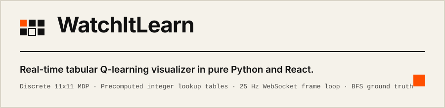
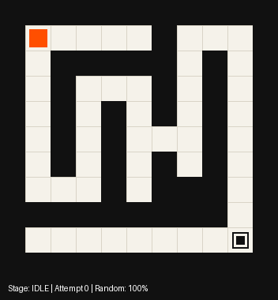
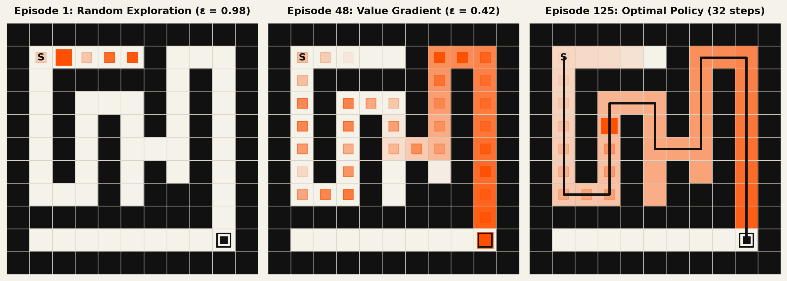
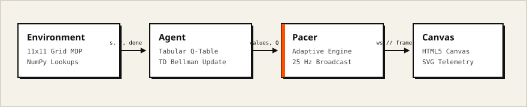
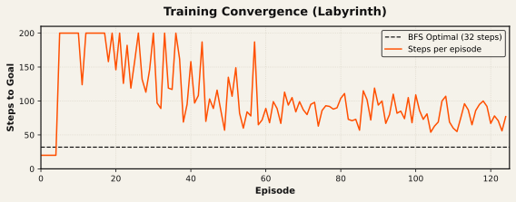

WatchItLearn is an interactive tabular Q-learning visualizer for discrete mazes built in Python and React.

- The agent learns from scratch with NumPy arrays and streams updates over WebSockets at 25 Hz.
- An exact breadth-first search solver provides a mathematical ground truth for convergence.
- A dual-pacing engine shows early random exploration slowly before batching accelerated training.

---

## Demo





Training phases from seed 42 on Labyrinth: episode 1 (random exploration, $\epsilon = 0.98$), episode 48 (value gradient diffusion, $\epsilon = 0.42$), and episode 125 (converged optimal policy, 32 steps).

---

## How to read the screen

- **Tiles**: dark ink tiles (`#111111`) are walls. Cream tiles (`#F5F2EA`) are floor. Orange tint shows state value $V(s) = \max_a Q(s, a)$, glowing brightest near the goal.
- **Markers**: `S` is start at (1, 1). Nested square is goal at (9, 9). Orange square is the agent with a fading footprint trail. A solid line traces the solved path.
- **Policy arrows**: in the evaluation report, black arrows indicate greedy action $\arg\max_a Q(s, a)$ at each cell.
- **Telemetry**: `Shortest` is BFS ground truth, `Best` is lowest route found, `Moves` is total transitions, and `Random` is exploration rate $\epsilon$.

---

## How it learns

$$Q(s, a) \leftarrow Q(s, a) + \alpha \left( r + \gamma \max_{a'} Q(s', a') - Q(s, a) \right)$$

The agent observes current tile $s$, selects move $a$, and receives reward $r$ with next tile $s'$. It updates its estimate $Q(s, a)$ by shifting toward the immediate reward plus discounted future value $\gamma \max_{a'} Q(s', a')$. Over repeated visits, positive goal reward diffuses backward along corridor junctions to the start.

Exploration decays linearly across training budget $T$ until reaching the floor at 70% of $T$:

$$\epsilon(t) = \max\left(\epsilon_{\text{floor}},\, \epsilon_{\text{start}} - \frac{t}{0.70 \cdot T} (\epsilon_{\text{start}} - \epsilon_{\text{floor}})\right)$$

| Hyperparameter | Value | Rationale in `app/config.py` |
| :--- | :--- | :--- |
| $\alpha$ (learning rate) | `0.50` | Balanced step size for deterministic transitions |
| $\gamma$ (discount factor) | `0.97` | Horizon for 32-step paths ($0.97^{32} \approx 0.38$) |
| $\epsilon_{\text{start}} \to \epsilon_{\text{floor}}$ | `1.0 -> 0.02` | Full initial exploration, retaining minimal randomness |
| $r_{\text{step}} \,/\, r_{\text{goal}}$ | `-0.01 / +1.0` | Step penalty discourages loops while rewarding goal reach |
| Step limit | `200` | Truncates divergent episodes in 121-state grid |



---

## Results

Measured across 20 independent seeds via `python scripts/benchmark.py`:

| Metric | Result | How measured |
| :--- | :--- | :--- |
| Convergence reliability | 100% (20/20 seeds on all 3 mazes) | 10 greedy rollouts matching BFS optimum |
| Labyrinth (32) median to solve | 63 episodes (IQM 63.1) · 7,796 transitions | Episodes to 3 consecutive optimal checks |
| Classic (28) median to solve | 56 episodes (IQM 56.2) · 6,824 transitions | Episodes to 3 consecutive optimal checks |
| Zig-Zag (32) median to solve | 66 episodes (IQM 65.6) · 8,028 transitions | Episodes to 3 consecutive optimal checks |
| Simulation throughput | 28,398 steps/s (232 ep/s) | Total transitions / wall-clock time (15.95s) |



Reproduce with: `python scripts/benchmark.py`

---

## Three things to try

- **Inspect the dead-end trap**: select Maze 1 (Labyrinth). Watch attempts 1 to 5 enter the eastward dead end at row 1 columns 2 to 5 before negative step penalties turn policy arrows south.
- **Inspect discrete updates**: set Speed to `Step by step`. Observe every transition at 100 steps/sec with live $Q(s, a)$ tile color adjustments.
- **Accelerate convergence**: set Speed to `Fast` (15s budget). The pacer ramps batch size from 2 to 152 attempts per frame, reaching convergence under 6 seconds of compute.

---

## Run it

Docker:
```bash
docker compose up --build # Open http://localhost:8000
```

Local:
```bash
pip install -r requirements.txt && uvicorn app.main:app --reload --port 8000 # Terminal 1
cd frontend && npm install && npm run dev                                    # Terminal 2 (http://localhost:5173)
```

---

## Design decisions

- **Tabular representation over neural networks**: exact Q-tables eliminate catastrophic forgetting and training instability in small discrete state spaces.
- **NumPy arrays over Python dictionaries**: integer-indexed arrays allow 28,000+ transitions per second by eliminating object hashing overhead.
- **WebSocket frame streaming over HTTP polling**: push streaming maintains a steady 25 Hz visual update rate without request-response latency spikes.
- **Dual pacing over uniform playback**: human-speed early episodes expose exploration failures, while batch processing accelerates repetitive value propagation.
- **BFS ground truth over empirical baselines**: deterministic graph search establishes a mathematical optimum to prove 100% convergence.

---

## Limitations

- **State-space scalability**: tabular $Q(s, a)$ requires memory $\mathcal{O}(|\mathcal{S}| \cdot |\mathcal{A}|)$, which becomes intractable on continuous domains without function approximation.
- **Deterministic environment**: transition tables assume transitions succeed with probability 1.0, without stochastic wind or slip.
- **Fixed topology**: training must reset whenever maze geometry changes because tabular state values do not generalize across layouts.
- **Single-agent discrete control**: the MDP models one agent moving in cardinal directions without momentum or continuous action bounds.

---

## Project structure

```text
├── app/
│   ├── agents.py        # Tabular Q-learning agent and ε-greedy selection
│   ├── config.py        # Hyperparameters, maze matrices, and frame schemas
│   ├── env.py           # Precomputed MDP transition tables and BFS solver
│   ├── evaluate.py      # Multi-seed headless benchmarking suite
│   ├── main.py          # FastAPI application and WebSocket streaming server
│   └── trainer.py       # Pacing engine, batch simulator, and frame loop
├── frontend/src/        # React 18, HTML5 Canvas, and SVG sparkline UI
├── docs/                # Architecture diagrams, visual assets, and report
├── scripts/             # Headless benchmark, chart, and verification scripts
├── Dockerfile           # Multi-stage production container build
└── docker-compose.yml   # Single-command application deployment
```

For the mathematical derivation and semester evaluation notes, see [ACADEMIC_REPORT.md](docs/ACADEMIC_REPORT.md). Distributed under the [MIT License](LICENSE).
